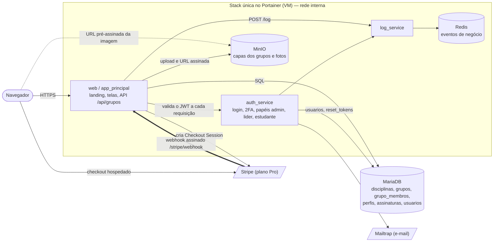
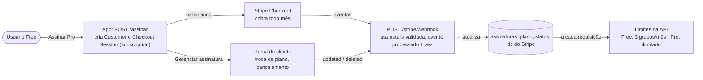

# 📚 StudyMatch

> **Encontre seu grupo de estudos ideal: match por disciplina e horário.**

Projeto da disciplina ISW055 (Introdução à Computação em Nuvem — FATEC), acompanhado pelo professor [github.com/siriani](https://github.com/siriani).
Este repositório é a continuação do **NicoFlix** (catálogo de filmes do Tom Hanks), espelhado com todo o histórico de commits. Arquitetura, documentação reversa e instruções de deploy do projeto original estão em [`docs/README_NicoFlix_filmes.md`](docs/README_NicoFlix_filmes.md).

**🌐 Sistema no ar:** https://nicollas-carvalho-isw055.lapps.studio — veja a seção [Atividade 10](#atividade-10--negócio-no-ar-studymatch).

---

## 1. Nome e frase

**StudyMatch** — um "Tinder" de grupos de estudo: você informa as disciplinas e os horários em que pode estudar, e a plataforma sugere pessoas e grupos compatíveis, para você entrar em um grupo ativo em minutos.

## 2. A dor

**Quem sofre:** estudantes de cursos superiores noturnos e semipresenciais (ex.: tecnólogos da FATEC), que estudam depois do trabalho e têm pouquíssimo tempo livre.

**Quando:** nas semanas que antecedem provas e entregas de trabalhos em grupo, quando surge a dúvida e não há com quem estudar.

**Quanto custa hoje** (hipóteses a validar com entrevistas na turma, não dados medidos):
- **Tempo:** horas por semana procurando parceiros por mensagens em grupos de turma, e mais horas combinando um horário que sirva para todos.
- **Dinheiro:** quem desiste de estudar em grupo recorre a aulas particulares ou plataformas pagas de reforço, ou perde nota por não entender a matéria.
- **Risco:** reprovação em disciplina, evasão, e trabalhos em grupo feitos às pressas com colegas que não se conhecem.

**Como resolvem hoje:** pedem parceiros no WhatsApp da turma e esperam alguém responder; os grupos que se formam muitas vezes esfriam depois de duas semanas, porque ninguém consegue combinar horário.

## 3. Persona

**Camila Ribeiro, 21 anos, 3º semestre de Análise e Desenvolvimento de Sistemas (noturno).**
Trabalha como assistente administrativa das 8h às 17h e entra na aula às 19h. Mora longe da faculdade, então só consegue estudar online, à noite, depois das 21h, ou aos sábados de manhã.
Em Banco de Dados, tem dificuldade com junções (JOIN) e prova marcada em duas semanas. Já mandou mensagem no grupo da turma, recebeu dois "também quero!", e o grupo nunca saiu do papel porque cada um só podia em um horário diferente.
O que a atrapalha: não sabe quem mais está na mesma dificuldade, não consegue achar um horário comum, e perde a motivação quando estuda sozinha.

## 4. Concorrentes e alternativas

| Alternativa | O que faz bem | O que faz mal |
|---|---|---|
| Grupos de WhatsApp da turma | Todo mundo já usa, é gratuito | Mensagens se perdem, não filtra por disciplina nem horário, não mostra quem está disponível |
| Servidores de Discord de estudo | Salas de voz, comunidade grande | Genérico e barulhento; difícil achar alguém da *sua* matéria e do *seu* horário |
| Planilhas / formulários de horários (Google Sheets) | Flexível e gratuito | Trabalho manual de alguém organizar; fica desatualizado rápido |
| Aulas particulares e plataformas de reforço | Atendimento direto, explicação individual | Caro e individual: não cria rede de apoio entre colegas |
| "Jeito de sempre": estudar sozinho ou combinar com amigos próximos | Sem custo e sem burocracia | Limitado ao círculo que você já conhece |

## 5. Proposta de valor

Diferente de grupos de mensagem e planilhas, o StudyMatch encontra para você **colegas da mesma disciplina com horário em comum**, em poucos toques, e mantém o grupo organizado.

## 6. Modelo de receita com Stripe

Assinatura mensal recorrente cobrada pelo Stripe (já integrado no projeto, em modo teste).

| | **Free — R$ 0,00** | **Pro — R$ 9,90/mês** |
|---|---|---|
| Grupos criados por líder | até **3 por mês** | **ilimitados** |
| Participar de grupos como estudante | sem limite | sem limite |
| Selo 👑 Pro no perfil | — | ✔ |
| Gerenciar/cancelar pelo portal do Stripe | — | ✔ |

**Por que alguém pagaria:** quem tem prova marcada e pouco tempo precisa participar de vários grupos (uma disciplina por grupo) e achar parceiros rápido. O limite do Free (3 grupos por mês) deixa o produto útil, mas pressiona o líder que organiza vários grupos de estudo no mês de provas. O preço de R$ 9,90 equivale a menos de uma hora de aula particular.

**Meta realista:** converter de 3% a 5% dos usuários ativos para o Pro.

## 7. Métricas de sucesso

| Métrica | Como medir | Meta inicial |
|---|---|---|
| Cadastros | usuários criados por semana | 50 na primeira turma-piloto |
| Grupos ativos | grupos com pelo menos 3 membros e 1 encontro marcado | 10 |
| Taxa de match → grupo | matches que viram participação em grupo | 30% |
| Assinantes Pro | linhas com `premium = 1` | 2 a 3 (3 a 5% dos ativos) |
| **MRR** (receita recorrente mensal) | assinantes Pro × R$ 9,90 | R$ 30 a R$ 50 no primeiro mês |
| Retenção em 30 dias | usuários que voltam 30 dias após o cadastro | 40% |

## 8. Lean Canvas

| Bloco | Conteúdo |
|---|---|
| **Problema** | 1) Achar colegas da mesma disciplina que também querem estudar. 2) Combinar um horário comum. 3) Manter o grupo ativo depois das primeiras semanas. Hoje: WhatsApp, planilhas e sorte. |
| **Segmentos de clientes** | Estudantes de graduação e tecnólogo, principalmente noturnos, que trabalham de dia. Primeiros adotantes: alunos do curso de ADS da FATEC. |
| **Proposta única de valor** | Match por disciplina e horário: você chega a um grupo de estudo ativo em minutos. |
| **Solução** | 1) Perfil com disciplinas e horários livres. 2) Match/swipe de colegas e grupos compatíveis. 3) Grupos com vagas, horário fixo e e-mail de aviso a cada novo match. |
| **Canais** | Indicação dentro da turma, divulgação nos grupos de WhatsApp dos cursos, cartazes e QR code na faculdade, centros acadêmicos. |
| **Fontes de receita** | Assinatura Pro de R$ 9,90/mês via Stripe. |
| **Estrutura de custos** | Servidor/VM (fornecido pela disciplina, custo zero na fase acadêmica; em produção, VM + banco), taxa do Stripe por transação, e-mail transacional, tempo de desenvolvimento. |
| **Métricas-chave** | Cadastros, grupos ativos, taxa de match → grupo, assinantes Pro, MRR, retenção em 30 dias. |
| **Vantagem injusta** | Acesso direto ao público (o autor é aluno da turma), conhecimento do calendário real de provas e o histórico de disciplinas e horários que a plataforma acumula (os dados dos usuários). |

## 9. Mapa de reaproveitamento

| Peça do projeto atual (NicoFlix) | O que vira no SaaS | Como fica no StudyMatch |
|---|---|---|
| Catálogo de filmes (TMDB) | Recurso principal do negócio | **Grupos de estudo e disciplinas**: disciplina, horário, vagas, modalidade (online/presencial). Os dados passam a vir do nosso próprio banco, sem API externa |
| Favoritos | Interação principal | **Curtidas/swipe** em grupos e colegas (com limite diário no Free) |
| Comentários | Comunicação | **Mensagem de apresentação** ao pedir entrada num grupo |
| Microsserviço de login + 2FA + redefinição de senha (e-mail) | Identidade | Mantidos; o e-mail também notifica os matches |
| RBAC (admin / usuario) | Papéis do negócio | **admin**, **líder de grupo** (cria e modera o grupo) e **estudante** |
| Logs e auditoria (Redis Streams) | Eventos de negócio | "match criado", "pedido de entrada", "entrada aceita", "grupo criado", "limite do plano atingido" |
| Upload e perfil (MinIO) | Arquivos do domínio | Foto de perfil, foto/capa do grupo, e anexos de material de estudo (PDF de resumo) |
| Plano Premium (Stripe) | Assinatura | **StudyMatch Pro**: grupos ilimitados e selo (Free: 3 grupos por mês) |
| Documentação reversa (Atividade 8) | Manutenção | Continua valendo; será atualizada a cada entrega |
| Testes automatizados (pytest) | Qualidade | Continuam, com novos testes para match e limites |
| Deploy via Portainer + Docker Compose | Entrega | Mesma stack, mesma infraestrutura e mesmo subdomínio |

## 10. Próximas entregas

O roteiro (backlog) está nas issues deste repositório e resumido em [`docs/BACKLOG.md`](docs/BACKLOG.md).

---

## Atividade 10 — Negócio no ar (StudyMatch)

**URL do sistema:** https://nicollas-carvalho-isw055.lapps.studio (landing page pública, sem login).

### O que mudou do NicoFlix para o StudyMatch
O catálogo de filmes saiu; entrou o recurso principal do negócio, o **grupo de estudo**. Login, papéis, logs, upload e Stripe foram mantidos e mudaram de assunto. A stack no Portainer é a mesma, apontando para este repositório.

### Arquitetura atualizada

### Papéis (auth-service)
| Papel | Como se obtém | Pode |
|---|---|---|
| `admin` | primeiro cadastro do sistema | ver e gerenciar todos os grupos, ver os logs |
| `lider` | escolhido no cadastro | criar, editar e apagar **os próprios** grupos (plano Free: 3 grupos por mês; Pro: ilimitados) |
| `estudante` | escolhido no cadastro | ver os grupos de que participa; **não** cria, edita nem apaga grupos |

As regras valem na API: ação proibida responde **403** mesmo chamando direto, sem passar pela tela. O usuário só vê e altera os próprios dados: abrir o ID de um grupo de outra pessoa responde **403** (registro inexistente responde 404).

### Modelo de dados e migração
Script versionado: [`db/001_dominio.sql`](db/001_dominio.sql) (tabelas `disciplinas`, `grupos`, `grupo_membros`, com chaves estrangeiras, e seed de disciplinas). O `app_principal` roda os `db/*.sql` em ordem ao iniciar; quem clonar o repositório recria o banco subindo a stack, ou manualmente com `mysql ... < db/001_dominio.sql`. `db/000_limpeza_legado.sql` remove as tabelas do projeto anterior.

### API REST de grupos
Autenticada pela sessão do navegador (ou `Authorization: Bearer <JWT>`).

| Método e rota | Função | Respostas |
|---|---|---|
| `GET /api/grupos` | lista os grupos que o usuário pode ver | 200, 401 |
| `POST /api/grupos` | cria (`titulo, disciplina_id, dia_semana 0-6, horario_inicio, horario_fim, vagas, modalidade, descricao`) | 201, 400, 403 (papel ou limite do plano grátis) |
| `GET /api/grupos/<id>` | detalha | 200, 403 (de outro usuário), 404 |
| `PUT /api/grupos/<id>` | edita | 200, 400, 403, 404 |
| `DELETE /api/grupos/<id>` | remove | 204, 403, 404 |
| `POST /api/grupos/<id>/foto` | capa do grupo (multipart `foto`, até 2 MB, JPEG/PNG/WEBP) → MinIO | 200, 400, 403 |
| `GET /api/disciplinas` | disciplinas disponíveis | 200 |

Para testar direto, com o login feito no navegador, abra o console (F12) e rode, por exemplo, `fetch('/api/grupos/1').then(r => console.log(r.status))`.

### Telas
`/` (landing pública) · `/grupos` (lista) · `/grupos/novo` · `/grupos/<id>` (detalhe e capa) · `/grupos/<id>/editar` · `/perfil` · `/admin/logs` (admin).

### Eventos de negócio no log
`grupo_criado`, `grupo_editado`, `grupo_removido`, `foto_grupo_enviada`, `limite_grupos_gratis_atingido`, `assinatura_*`, `403_*` (acessos negados), além de login e logout. O admin vê tudo em `/admin/logs`, com usuário, ação, IP e data.

### Plano Pro (Stripe)
Free: 3 grupos criados por mês por líder. Pro, R$ 9,90/mês: grupos ilimitados e selo 👑. Detalhes na seção da Atividade 11 abaixo.

### Trocar a stack do Portainer para este repositório
Stacks → sua stack → *Editor* → em **Repository URL** coloque `https://github.com/NicollasZoratto/Smart-STUDY-Match` (branch `main`), mantenha as variáveis de ambiente (remova `TMDB_API_KEY` se existir) → *Pull and redeploy*.

---

## Atividade 11 — SaaS completo: planos, limites e assinatura com Stripe

> Tudo em **modo de teste** do Stripe. Nenhuma chave está no repositório: elas ficam nas variáveis de ambiente da stack no Portainer (`.env.example` só traz os nomes). Dado de cartão nunca passa pelo nosso servidor.

### Planos
| Plano | Preço | Limite |
|---|---|---|
| **Free** (padrão ao criar conta; no banco é `plano = 'free'`) | R$ 0,00 | líder cria até **3 grupos por mês** |
| **Pro** (produto "StudyMatch Pro" no Stripe, preço recorrente mensal) | R$ 9,90/mês | sem limite |

### Ciclo de vida da assinatura

O plano muda **só quando o webhook chega**, nunca porque o navegador voltou do checkout. Toda rota que depende do plano consulta o banco a cada requisição, então o limite do Free vale na API e não só na tela.

### Webhooks (`POST /stripe/webhook`)
| Evento | O que o app faz |
|---|---|
| `checkout.session.completed` | guarda `customer` e `subscription` no usuário e muda o plano para **Pro** (`status = active`) |
| `customer.subscription.updated` | atualiza status, preço e "cancelar no fim do período"; Pro só enquanto o status for `active`/`trialing` |
| `customer.subscription.deleted` | volta o usuário para o **Free** (`status = canceled`) |
| `invoice.payment_failed` | marca `past_due`, tira o Pro e mostra o aviso de cobrança falha no perfil |

- **Assinatura validada:** `stripe.Webhook.construct_event` com o `whsec_...`; sem assinatura válida responde 400 e nada é gravado.
- **Sem efeito duplicado:** cada `event.id` é gravado em `stripe_eventos` (`INSERT IGNORE`, script `db/002_assinaturas.sql`). Evento repetido responde 200 e é ignorado. Se o processamento falha, a marca é desfeita e a resposta é 500, para o Stripe reenviar.
- **Ordem não garantida:** o Customer é criado antes do checkout, então qualquer evento acha o usuário pelo `customer`, mesmo chegando antes do `checkout.session.completed`.

### Portal do cliente
O botão **"Gerenciar assinatura"** (em `/perfil`) chama `POST /assinatura/portal`, que abre o Billing Portal do Stripe para o próprio Customer do usuário logado. Lá o cliente troca de plano e cancela sozinho.

### Limite do Free na API
`POST /api/grupos` e a tela de novo grupo recusam o 4º grupo do mês com **403** e a mensagem: *"Limite do plano Free atingido: 3 grupos por mês. Para liberar, assine o StudyMatch Pro em /perfil (botão 'Assinar Pro')."*

### Painel admin (`/admin/painel`, só admin)
Usuários por plano (Free x Pro), assinaturas ativas, inadimplentes, **MRR de teste** (assinaturas ativas × R$ 9,90) e os últimos eventos do log. Outro papel recebe 403.

### Variáveis de ambiente (Portainer)
| Variável | Valor |
|---|---|
| `STRIPE_SECRET_KEY` | chave secreta de teste (`sk_test_...`) |
| `STRIPE_WEBHOOK_SECRET` | segredo do destino do webhook (`whsec_...`) |
| `STRIPE_PRICE_ID` | ID do preço recorrente do Pro (`price_...`); se vazio, o app cria o preço inline de R$ 9,90 |
| `GRUPOS_LIMITE_GRATIS` | grupos por mês no Free (padrão 3) |

### Configuração no Stripe (modo de teste)
1. **Produtos:** *Product catalog* → "StudyMatch Pro" (R$ 9,90, recorrente mensal) e, se quiser, "StudyMatch Free" (R$ 0,00, recorrente mensal).
2. **Webhook:** destino com a URL `https://nicollas-carvalho-isw055.lapps.studio/stripe/webhook` e os quatro eventos da tabela acima.
3. **Portal do cliente:** *Settings → Billing → Customer portal* (em modo de teste): habilitar cancelamento de assinatura e, para testar na hora, cancelamento **imediato**; habilitar troca de plano se houver mais de um preço.

### Cenário de teste
1. Criar uma conta nova (nasce no Free) e criar 3 grupos; o 4º é recusado com a mensagem do limite.
2. Em `/perfil`, **Assinar Pro** e pagar com o cartão `4242 4242 4242 4242` (data futura, qualquer CVC).
3. Voltar ao app: plano Pro e limite liberado, porque o webhook chegou.
4. **Gerenciar assinatura** → cancelar; quando o webhook `customer.subscription.deleted` chega, a conta volta ao Free.
5. Como admin, abrir `/admin/painel` e `/admin/logs`.
6. Para testar cobrança recusada, usar um cartão de teste que falha na renovação (ver a documentação *Testing* do Stripe).

### Testes automatizados
`tests/test_premium.py`: assinatura inválida/forjada/adulterada (400), os quatro eventos, evento duplicado sem efeito, erro → 500, checkout (`mode=subscription` ligado ao Customer), portal e painel admin.

### Evidências da Atividade 11 (prints, modo de teste)
Dados pessoais (e-mail e nome do titular) foram borrados.

| # | Print |
|---|---|
| 1 | [Stack no Portainer com os containers saudáveis](docs/prints/atividade-11/01-portainer-stack-saudavel.png) |
| 2 | [Limite do plano Free bloqueando o 4º grupo](docs/prints/atividade-11/02-limite-plano-free-403.png) |
| 3 | [Checkout de assinatura com o cartão 4242](docs/prints/atividade-11/03-checkout-stripe-cartao-4242.png) |
| 4 | [Perfil já no plano Pro (webhook processado)](docs/prints/atividade-11/04-perfil-plano-pro.png) |
| 5 | [Quarto grupo criado depois de assinar o Pro](docs/prints/atividade-11/05-grupos-apos-assinar-pro.png) |
| 6 | [Stripe (modo de teste): cliente criado](docs/prints/atividade-11/06-stripe-clientes-teste.png) |
| 7 | [Stripe: webhook `checkout.session.completed` entregue com 200](docs/prints/atividade-11/07-stripe-webhook-200.png) |
| 8 | [Perfil de volta ao Free depois do cancelamento](docs/prints/atividade-11/08-perfil-volta-ao-free.png) |
