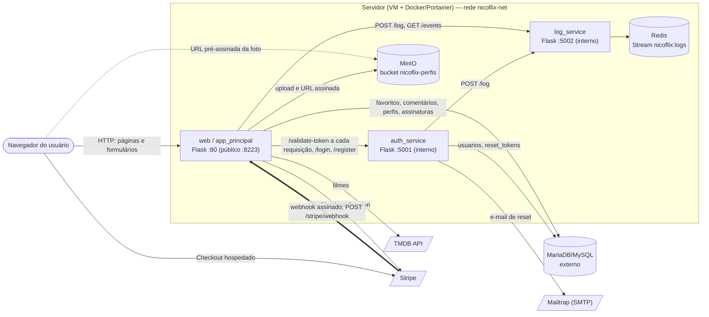
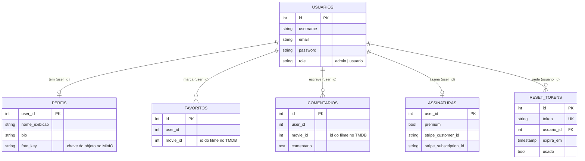

# 🎬 Catálogo de Filmes - Tom Hanks - NicoFlix

Projeto desenvolvido para a disciplina de Cloud Computing na FATEC.

## 👨‍🏫 Professor Responsável

- Professor **@siriani** — [github.com/siriani](https://github.com/siriani)

## 📄 Relatório (P1 — ISW055)

- [P1_ISW055_Nicollas_Zoratto.pdf](docs/P1_ISW055_Nicollas_Zoratto.pdf)

## 🚀 Arquitetura e Tecnologias

- **Consumo de API:** TMDB (The Movie Database) para dados e pôsteres em tempo real.
- **Backend:** Python / Flask, dividido em três containers (`web`, `auth_service`, `log_service`) + `redis` + `minio`.
- **Persistência de Dados:** MariaDB / MySQL (usuários, papéis, favoritos, comentários, perfis) + Redis Streams (log de auditoria) + MinIO (fotos de perfil).
- **Containerização:** Docker e Portainer.

```
Navegador ──HTTPS──▶ web (único ponto público de app, :8223)
             │
             ├──rede interna──▶ auth_service (login, papéis, esqueci-senha)
             │                        └──envia e-mail──▶ Mailtrap/Brevo (SMTP)
             │
             ├──rede interna──▶ log_service (auditoria) ──▶ redis (Streams)
             │
             └──direto (URL pré-assinada)──▶ minio :9000 (fotos de perfil)
```

`auth_service`, `log_service` e `redis` não publicam porta pro host — só acessíveis pela rede interna do Docker. O `minio` é a **única exceção**: sua porta de API (9000) precisa ficar pública, porque é o navegador do usuário — não o backend — quem busca a foto direto de lá. A porta publicada é alta (`29517`) para não colidir com outros alunos no servidor compartilhado (ver seção MinIO abaixo).

## 🔐 Autenticação e papéis (Atividades 3 e 4)

- **Papéis de usuário:** cada usuário tem uma coluna `role` (`usuario` ou `admin`). O primeiro usuário cadastrado vira `admin` automaticamente.
- **Esqueci minha senha:** token com expiração de 30 minutos, enviado por e-mail.

### Permissões por papel

**`usuario`:** login/cadastro/logout, redefinição de senha, ver catálogo, favoritar/desfavoritar, criar/editar/apagar o **próprio** comentário, **editar o próprio perfil e trocar a própria foto**.

**`admin` (tudo que `usuario` pode, mais):** apagar comentário de **qualquer usuário** (`/admin/comentarios`), consultar os logs de auditoria (`/admin/logs`).

### Padrão A ou B?

Na prática, **Padrão A (enforcement centralizado)**: o catálogo não tem o `JWT_SECRET`, então chama `/validate-token` no `auth_service` a cada ação — o mesmo custo de rede do Padrão A, mesmo o papel estando dentro do JWT. Pra virar Padrão B de verdade, precisaria compartilhar a chave (ou migrar pra RS256 com chave pública) e decodificar localmente, trocando latência menor por mudanças de papel só surtirem efeito quando o token expirar.

## 📜 Logs e auditoria (Atividade 5)

Microsserviço `log_service`, Redis Streams (`XADD`/`XREVRANGE`), sem porta publicada. Loga login, logout, favoritar/desfavoritar, comentar, apagar comentário, **editar perfil, trocar foto de perfil**, e todo 403 (moderação, logs, comentário de outro, **editar perfil de outro, upload de foto de outro**). Consulta em `/admin/logs`, só admin.

## 👤 Perfil e foto (Atividade 6)

### Página de perfil

`/perfil` mostra nome de exibição, bio (até 280 caracteres), foto, e a lista de filmes favoritados (reaproveitando a tabela `favoritos` que já existe desde a atividade 2) — formato de perfil de rede social simples. Os dados ficam numa tabela nova, `perfis`, na mesma base do catálogo:

```sql
CREATE TABLE perfis (
    user_id INT PRIMARY KEY,
    nome_exibicao VARCHAR(100) NOT NULL,
    bio VARCHAR(280) NOT NULL DEFAULT '',
    foto_key VARCHAR(255),              -- chave do objeto no MinIO, não a imagem em si
    atualizado_em TIMESTAMP DEFAULT CURRENT_TIMESTAMP ON UPDATE CURRENT_TIMESTAMP
)
```

Ficou numa tabela própria do catálogo (não dentro de `usuarios`, que pertence ao `auth_service`) pelo mesmo motivo que `comentarios`/`favoritos` já são do catálogo: é conteúdo social/de perfil, não dado de identidade/autenticação.

### Upload de foto → MinIO + MariaDB

1. O arquivo chega em `POST /perfil/<user_id>/foto`, como `multipart/form-data`.
2. **Validação antes de aceitar:**
   - Tamanho: rejeitado se passar de **2 MB** (`MAX_FOTO_SIZE_BYTES`).
   - Tipo: não confiamos no `Content-Type` que o navegador manda (é só um header, fácil de forjar) — abrimos o arquivo de verdade com **Pillow** (`Image.open(...).verify()`) e só aceitamos se decodificar como JPEG, PNG ou WEBP.
3. O arquivo vai pro MinIO com uma chave única (`perfis/<user_id>/<uuid>.<ext>`), no bucket **`nicoflix-perfis`**.
4. Só a **chave do objeto** (`foto_key`) é salva no MariaDB, na tabela `perfis` — nunca a imagem em si.
5. A foto antiga (se houver) é apagada do MinIO ao trocar, pra não acumular lixo no bucket.

### Exibir a imagem de volta — bucket público vs. URL pré-assinada

**Decisão: URL pré-assinada (temporária), não bucket público.**

| | Bucket público | URL pré-assinada (escolhida) |
|---|---|---|
| Simplicidade | Mais simples — só salva a URL fixa | Precisa gerar uma URL nova a cada vez que a página carrega |
| Controle de acesso | Qualquer um com o link vê a foto pra sempre, mesmo depois de trocada/removida | Expira em **1 hora** (`PRESIGNED_URL_EXPIRY_SECONDS`); passou disso, o link não funciona mais |
| Exposição | O bucket inteiro fica de leitura pública — se alguém adivinhar/vazar uma chave de outro objeto, também vê | Cada URL só dá acesso a UM objeto específico, por tempo limitado |
| Troca de assunto de privacidade | Foto "deletada" ainda é alcançável por quem guardou o link antigo (cache, histórico) | Link velho simplesmente para de funcionar |

Optamos pela URL pré-assinada porque o trade-off de "gerar de novo a cada carregamento de página" é barato (é só uma assinatura criptográfica local, não uma chamada de rede extra) e o ganho de controle — expiração automática, sem depender de lembrar de revogar nada — compensa a complexidade extra. A implementação usa dois clientes MinIO no `app_principal`: um com o endpoint **interno** (`minio:9000`, rede Docker, rápido) pra upload/remoção reais, e outro com o endpoint **público** (deduzido do endereço aberto no navegador + `MINIO_API_HOST_PORT`, padrão `29517`) só pra **assinar** a URL que o navegador vai usar — por isso a porta 9000 do MinIO precisa estar publicada, diferente dos outros serviços internos deste projeto.

### Cada um só edita o próprio perfil

`POST /perfil/<user_id>/editar` e `POST /perfil/<user_id>/foto` conferem `user_id` (da URL) contra o `user_id` de quem está logado (vindo do JWT validado pelo `auth_service`, nunca do corpo da requisição). Diferente → **403**, mesmo chamando direto pelo Postman/curl com a sessão de outro usuário. Mesma lógica das atividades 4/5, reaproveitada aqui.

## ✉️ E-mail via Mailtrap

1. Copie `.env.example` para `.env`.
2. Preencha `SMTP_HOST`, `SMTP_USER`, `SMTP_PASS` com as credenciais da sua inbox em [mailtrap.io](https://mailtrap.io) (Email Testing → Inboxes → SMTP Settings → aba "Flask"/"Python").
3. Sem isso preenchido, o link de redefinição só aparece no log do `auth_service`.

## 🪣 MinIO — configuração

No `.env`, ajuste:
- `MINIO_ROOT_USER` / `MINIO_ROOT_PASSWORD` — credenciais administrativas do MinIO (troque o padrão em produção).
- `MINIO_API_HOST_PORT` — porta do host onde a API do MinIO é publicada (padrão `29517`; troque se estiver ocupada). `PUBLIC_MINIO_ENDPOINT` pode ficar vazio: o app usa o mesmo host que você abriu no navegador.
- O console web do MinIO (9001) não é publicado, para evitar conflito de porta no servidor compartilhado.

## 🧪 Testes

```bash
pip install --break-system-packages -r auth_service/requirements.txt -r app_principal/requirements.txt -r log_service/requirements.txt -r tests/requirements-dev.txt
python -m pytest tests/ -v
```

26 testes (mockando MySQL, Redis e MinIO — não precisa de containers rodando), incluindo: papel do primeiro usuário, login/JWT, 403 em moderação/logs/comentário de terceiro, **403 ao editar perfil ou trocar foto de outro usuário**, **rejeição de arquivo que não é imagem**, **rejeição de arquivo acima do limite de tamanho**, e upload válido salvando no MinIO + MariaDB.

## 🎨 Front-end

Paleta índigo/ciano, tipografia Inter + Space Grotesk, sem depender de Bootstrap. Nova página de perfil com avatar circular, placeholder com inicial do nome quando não há foto, e grid de favoritos reaproveitando o estilo dos cards do catálogo.

## 📸 Demonstração (para entrega)

- Print do perfil com a foto enviada aparecendo de verdade (upload → `/perfil` mostrando o avatar).
- Print da tentativa de `POST /perfil/<id-de-outro-usuário>/editar` (ou `/foto`) logado como outro usuário, mostrando o **403**.
- `docker-compose.yml` com o serviço `minio` (ver acima).

## 🔒 Segurança

- Credenciais sensíveis vêm de `.env` (fora do Git — `.gitignore`), nunca hardcoded no `docker-compose.yml` versionado.
- `auth_service`, `log_service` e `redis` não publicam porta; `minio` publica só a API (9000), necessária pras URLs pré-assinadas funcionarem — o console (9001) é opcional/debug.
- Upload de foto valida tipo por conteúdo real (Pillow), não por header, e limita tamanho antes de qualquer gravação.
- `/forgot-password` sempre devolve a mesma mensagem genérica, evitando enumeração de usuários.

---

## Atividade 7 — Assinatura Premium com Stripe (modo teste)

**Benefício verificável:** usuário do plano grátis pode ter no máximo `FAVORITOS_LIMITE_GRATIS` (5) favoritos — o limite é aplicado no **backend** (`POST /favoritar`), não só na tela. Usuário **Premium** tem favoritos ilimitados e o selo 👑 *Premium* ao lado do nome (catálogo e perfil).

### Rotas
| Rota | Função |
|---|---|
| `POST /assinar` | Exige login; cria uma *Checkout Session* (`mode=subscription`) com `client_reference_id` = id do JWT validado e redireciona (303) ao Stripe. |
| `GET /assinatura/sucesso` | Apenas informativa. **Não** concede Premium. |
| `POST /stripe/webhook` | Valida a assinatura `Stripe-Signature` (`stripe.Webhook.construct_event`); sem assinatura válida → **400**, nada é gravado. Em `checkout.session.completed` (pago) grava `premium=1`; em `customer.subscription.deleted` grava `premium=0`. |

### Segurança
- Premium só é concedido pelo **webhook assinado**, nunca pelo redirecionamento do navegador.
- **Nenhum dado de cartão** passa pelo servidor nem pelo banco: tabela `assinaturas(user_id, premium, stripe_customer_id, stripe_subscription_id)`.
- Chaves (`sk_test_…`, `whsec_…`) só em variáveis de ambiente (Portainer); nada no Git.
- Processamento idempotente (`ON DUPLICATE KEY UPDATE`): eventos repetidos não causam efeito duplicado.

### Configuração (conta Stripe gratuita, *Test mode*)
1. **Produto/preço:** Product catalog → *Add product* → "Plano Premium", recorrente mensal, **R$ 9,90** → copie o `price_...` (opcional; sem ele o app cria o preço inline).
2. **Chave secreta:** Developers → API keys → *Secret key* (`sk_test_...`).
3. **Webhook:** Developers → Webhooks → *Add endpoint* → URL `https://SEU_DOMINIO/stripe/webhook`, eventos `checkout.session.completed` e `customer.subscription.deleted` → copie o *Signing secret* (`whsec_...`).
   - Endpoints cadastrados no Dashboard normalmente exigem **HTTPS público**. Se o servidor só tem `http://IP:8223`, use o **Stripe CLI** (instalado na sua máquina):
     `stripe listen --forward-to http://IP_DO_SERVIDOR:8223/stripe/webhook`
     — ele imprime um `whsec_...` próprio; use **esse** valor em `STRIPE_WEBHOOK_SECRET`. (Alternativa: túnel HTTPS, ex. ngrok.)
4. No Portainer → Stack → *Environment variables*: `STRIPE_SECRET_KEY`, `STRIPE_WEBHOOK_SECRET`, `STRIPE_PRICE_ID` → *Pull and redeploy*.

### Como demonstrar
1. Logue como usuário comum, favorite 5 filmes; o 6º é bloqueado (aviso + log `limite_favoritos_gratis_atingido`).
2. Clique em **Assinar Premium**, pague com o cartão de teste `4242 4242 4242 4242` (qualquer data futura, CVC e CEP).
3. Stripe envia o webhook → selo 👑 aparece e o 6º favorito passa a funcionar. Em `/admin/logs` aparece `assinatura_premium_ativada`.
4. Prova da assinatura: `curl -X POST http://HOST:8223/stripe/webhook -d '{}'` → **400**.

### Testes
`pytest tests/test_premium.py` — webhook sem assinatura, assinatura forjada, corpo adulterado e assinatura válida (HMAC real), checkout e limite de favoritos.

---

## Atividade 8 — Classificação de serviços e documentação reversa

> Escrito a partir da leitura do código (`app_principal/app.py`, `auth_service/app.py`, `log_service/app.py`, `docker-compose.yml`), não de memória.

### 1. Classificação SaaS / PaaS / IaaS

| Peça do sistema | Camada | Justificativa |
|---|---|---|
| Servidor/VM da disciplina (host onde roda o Docker) | **IaaS** | Recebemos uma máquina virtual (CPU, disco, rede, IP público); sistema operacional e tudo acima são responsabilidade nossa. |
| Docker + Docker Compose + Portainer | **CaaS** (entre IaaS e PaaS) | O Portainer faz o build e o *redeploy* da stack a partir do GitHub, sem configurarmos o servidor à mão, mas ainda definimos imagens, portas e rede. |
| Containers `web` (catálogo), `auth_service` e `log_service` | Código nosso, rodando sobre IaaS/CaaS | Somos donos do código, das atualizações e da segurança dessas aplicações. |
| Redis (container `redis`) | **IaaS** (auto-hospedado) | Software open source que nós subimos e operamos; ninguém o gerencia por nós. |
| MinIO (container `minio`) | **IaaS** (auto-hospedado) | Armazenamento de objetos compatível com S3 que nós operamos, em volume próprio (`minio_data`). Equivale ao que seria um S3 na nuvem, mas sem gerenciamento. |
| Banco MariaDB/MySQL (host externo configurado em `DB_HOST`) | **PaaS** (banco como serviço) | O banco é fornecido e mantido pela disciplina; só usamos o schema (tabelas e consultas), sem administrar o servidor. |
| Stripe (Checkout + webhooks) | **SaaS** (consumido por API) | Pagamento pronto: tela de checkout, cobrança recorrente e cartão ficam com o Stripe. Só integramos por API/webhook. |
| TMDB (catálogo de filmes) | **SaaS** (API) | Serviço externo pronto; só consultamos os dados dos filmes com uma chave de API. |
| Mailtrap/SMTP (e-mail de redefinição de senha) | **SaaS** | Envio de e-mail feito por serviço externo via SMTP; sem SMTP configurado, o link só é impresso no log (modo dev). |
| GitHub (repositório) | **SaaS** | Hospeda o código e é a fonte que o Portainer usa no *Pull and redeploy*. |

### 2. Documentação reversa — Especificação (visão de quem usa)

NicoFlix é um catálogo da filmografia de Tom Hanks com contas de usuário.

- **Cadastro e login:** o usuário se cadastra com nome, e-mail e senha. O login tem duas etapas: senha e depois um código de 6 dígitos (2FA). O primeiro usuário cadastrado vira **admin**; os demais são **usuario**. A sessão dura 2 horas.
- **Recuperação de senha:** "Esqueci a senha" envia por e-mail um link de uso único que vale 30 minutos.
- **Catálogo:** lista os filmes de Tom Hanks (dados do TMDB) com pôster, título e sinopse.
- **Favoritos:** o usuário marca e desmarca filmes. No plano grátis o limite é de 5; no Premium não há limite.
- **Comentários:** cada usuário tem no máximo um comentário por filme, e escrever de novo substitui o anterior. O usuário apaga os seus; o admin pode apagar de qualquer um, na tela de moderação.
- **Perfil e avatar:** o usuário edita nome de exibição, bio e foto (JPEG/PNG/WEBP, até 2 MB). A foto fica no MinIO e é exibida por um link temporário.
- **Plano Premium:** o botão "Assinar Premium" (R$ 9,90/mês) leva ao checkout do Stripe. Depois do pagamento confirmado, o usuário ganha o selo 👑 e favoritos ilimitados. Se a assinatura for cancelada, volta ao plano grátis.
- **Logs de auditoria (admin):** o admin vê as últimas 100 ações (login, logout, favoritos, comentários, perfil, assinatura e acessos negados) com usuário, data e IP.

### 3. Documentação reversa — Arquitetura



Pontos importantes:
- Só o `web` (porta 8223) e a API do MinIO (porta 29517) são publicados. `auth_service`, `log_service` e `redis` ficam só na rede interna do Docker.
- O navegador nunca fala direto com `auth_service` e `log_service`: tudo passa pelo `web`.
- A foto de perfil é a exceção: o navegador baixa direto do MinIO por uma URL pré-assinada e temporária (1 h).
- O Stripe é quem chama o `web` (webhook); o Premium só é concedido por essa chamada, depois de validar a assinatura criptográfica.

### 4. Documentação reversa — Regras de negócio

**Autenticação**
- Se não existir nenhum usuário cadastrado, o primeiro cadastro recebe o papel `admin`; senão, `usuario`.
- Se usuário ou e-mail já existem, o cadastro é recusado (409).
- Se as credenciais estão corretas, o sistema gera um código 2FA de 6 dígitos; o login só termina com o código correto.
- Se o código 2FA estiver certo, o sistema emite um JWT com validade de 2 horas; se o JWT expirar, o usuário volta ao login.
- Se o link de redefinição de senha tiver mais de 30 minutos, ou já tiver sido usado, ele é recusado.
- A cada requisição, o `web` valida o JWT no `auth_service`; sem token válido, o usuário é redirecionado ao login.

**Permissões (RBAC)**
- Se o usuário não é admin, o acesso a `/admin/comentarios` e `/admin/logs` retorna 403 e a tentativa é registrada no log.
- Se um usuário comum tenta apagar o comentário de outro, recebe 403; o admin pode apagar de qualquer um.
- Se o `user_id` da URL de edição de perfil ou de foto é diferente do usuário logado, retorna 403 (vale até para admin) e o evento é registrado.

**Conteúdo**
- Se o usuário comenta duas vezes no mesmo filme, o segundo comentário substitui o primeiro (um por usuário e filme).
- Se o usuário favorita um filme já favoritado, o favorito é removido (o mesmo botão alterna).
- Nome de exibição: até 100 caracteres. Bio: até 280.
- Se a foto passa de 2 MB, não é uma imagem válida ou não é JPEG/PNG/WEBP, o upload é recusado.

**Premium**
- Se o usuário é do plano grátis e já tem 5 favoritos, o 6º é bloqueado (checado no backend) e o evento é registrado.
- Se o usuário é Premium, não há limite de favoritos.
- Se o pagamento é confirmado (`checkout.session.completed` pago), o usuário vira Premium. Se a assinatura é cancelada (`customer.subscription.deleted`), deixa de ser.
- Se o webhook chega sem assinatura válida do Stripe, é rejeitado (400) e nada é gravado.
- Voltar do checkout para o site não concede Premium; só o webhook concede.
- Nenhum dado de cartão é armazenado; só os IDs de cliente e assinatura do Stripe.

**Auditoria**
- Ações relevantes (login, logout, favoritar, comentar, perfil, assinatura, acessos negados) são enviadas ao `log_service` e gravadas no Redis Stream, que guarda no máximo 10.000 eventos. Se o log_service estiver fora do ar, a ação do usuário continua funcionando e só o registro é perdido.

### 5. Documentação reversa — Modelo de dados



- **Filmes** não têm tabela: vêm do TMDB e são referenciados só pelo `movie_id`.
- **Log** não é tabela: são entradas do Redis Stream `nicoflix:logs` (usuário, ação, IP, data).
- **Foto:** o arquivo fica no MinIO e o banco guarda só a chave (`foto_key`).
- **Sessão Premium** é a tabela `assinaturas`. `favoritos`, `comentários` e `perfis` têm chave única em `(user_id, movie_id)` ou em `user_id`, o que garante um registro por usuário e filme.
- Só `reset_tokens` tem chave estrangeira real (para `usuarios`). Nas demais tabelas o vínculo com o usuário é lógico, por `user_id`, porque a tabela `usuarios` pertence ao `auth_service` e as outras ao `web`.

### Limitações conhecidas (encontradas ao ler o código)
- As **senhas são gravadas em texto puro** em `usuarios.password` e comparadas diretamente; o correto seria guardar um hash (ex.: `werkzeug.security.generate_password_hash`).
- O `auth_service` executa `DROP TABLE usuarios` a cada inicialização: os ids recomeçam, e `perfis`, `favoritos`, `comentarios` e `assinaturas` podem ficar ligados a usuários que não existem mais ou ser herdados por um novo usuário.
- O código 2FA é devolvido na resposta do login (`dev_code`) e mostrado na tela, e não tem prazo de expiração, apesar da mensagem de erro dizer "expirado". Serve para a demonstração, não para produção.
- O texto do comentário e o `movie_id` não são validados no servidor.
